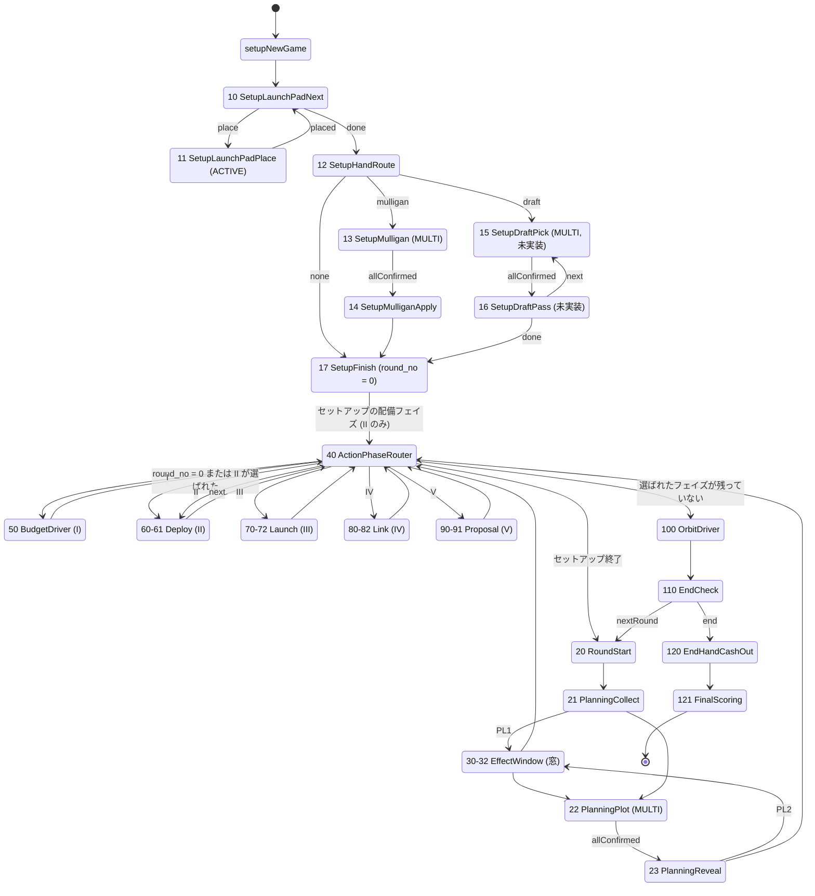
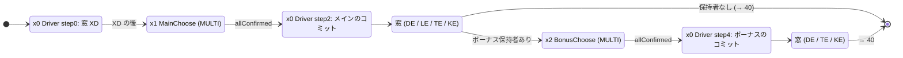
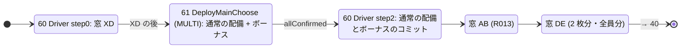

# 009: 状態遷移の設計

| 項目 | 内容 |
| --- | --- |
| ステータス | Approved |
| 対応タスク | T-009 |
| 作成日 | 2026-10-19 |
| 関連仕様書 | 001（ゲームルール）、004（BGA 構成・技術方針 §5）、007（効果の処理順と同時処理）、008（アナログ特有の操作）。参照: 002、003。後続: 010（データモデル・通知）、011（カード効果）、012（UI） |

## 目的

セットアップからゲーム終了までの全状態（状態クラス）、遷移、各状態のアクティブプレイヤーと可能なアクション、同時選択の収集と一斉処理、カード効果による選択の割り込み、zombie・タイムアウトの扱い、ゲーム進行度を定める。実装者がこの仕様書と承認済み仕様書（001・004・007・008）だけで、`src/modules/php/States/` の状態機械の骨格を作れるようにする。

## スコープ

- 対象: 状態の一覧（ID・クラス名・種類・遷移・アクション）、ID の割り当て規則、全体の遷移図、007 の「窓」を開く状態と割り込みの戻り先、同時選択の共通パターン（004 未確定事項 No.2 の案 A / 案 B どちらでも状態構成が変わらない形）、起動効果の使用済みリセットの位置、売却が可能な状態、zombie・タイムアウトの既定動作、ゲーム進行度の式、エッジケース
- 対象外: DB スキーマ・通知の詳細（→ 010）、効果ごとの実装と効果ごとの選択肢（→ 011）、画面の見た目（→ 012）。ルールそのもの（001 が正）、処理順の規則そのもの（007 が正）。この仕様書ではコードを書かない（擬似コードは設計の説明用）

## 記法と調査の前提

- **【確認】** は BGA 公式ドキュメントで確認した事実。**【提案】** は本書の設計案。**【未確認】** は公式ドキュメントから判断できず、Studio での検証に回す事項（「Studio で検証する点」にまとめる）。
- 根拠の `001 §N` `004 §N` `007 §N` `008 §N` は各仕様書の節、`Q-NN` は [rule-questions.md](../development/rule-questions.md)、`U-N` は 001 の未確定事項、`未確定 N` は本書末尾の未確定事項の No.。
- 調査日は 2026-10-19。ページは WebFetch（本文を要約して返すツール）で取得したため要約を介した確認であり、長いページ（Game.php）は末尾まで読み切れていない。API は更新が速いので実装時に再確認する。
- 参考にした姉妹リポジトリ: minimum-journey-bga の `docs/specs/006-state-machine.md` と `src/modules/php/States/`（`PrepChoice.php`、`RoundStart.php` など）。

確認に使った BGA 公式ページ:

| 略称 | URL |
| --- | --- |
| StateDir | <https://en.doc.boardgamearena.com/State_classes:_State_directory> |
| StatesInc | <https://en.doc.boardgamearena.com/Your_game_state_machine:_states.inc.php> |
| GamePhp | <https://en.doc.boardgamearena.com/Main_game_logic:_Game.php> |
| Zombie | <https://en.doc.boardgamearena.com/Zombie_Mode> |

## 仕様

### 1. BGA の仕組みの確認結果

#### 1.1 【確認】した事実

| No. | 事実 | 出典 |
| --- | --- | --- |
| B1 | 状態クラスは `GameState` を継承し、コンストラクタに `$game`、`id`、`type`（必須）と `name`・`description`・`descriptionMyTurn`・`transitions`・`updateGameProgression`・`initialPrivate`（任意）を渡す。ACTIVE_PLAYER / MULTIPLE_ACTIVE_PLAYER では `descriptionMyTurn` も実質必須。`type` は `ACTIVE_PLAYER` / `MULTIPLE_ACTIVE_PLAYER` / `PRIVATE` / `GAME` | StateDir |
| B2 | 状態 ID は一意の正の整数。**1 と 99 は予約**。稼働中のゲームで ID を変えると壊れる | StateDir、StatesInc |
| B3 | `transitions` は遷移名 → 状態 ID の対応。`onEnteringState` の戻り値に、状態クラス名・状態 ID（int）・遷移名のいずれかを返すと遷移する。戻り値で遷移するときは `nextState` を併用しない（二重遷移になる） | StateDir |
| B4 | アクションは `act*` メソッドに `#[PossibleAction]`。呼び出し時のアクティブ検査は `#[CheckAction(false)]` で外せる。外したら `checkPossibleAction()`（アクティブかを見ない検査）などで自前検証する | GamePhp |
| B5 | `getArgs()` の戻り値は全員に公開。本人だけに見せる値は `_private`（プレイヤー ID をキー）。private データは multiactive 状態を遅くしうる。`_no_notify` で自動スキップする状態をフロントに通知しない | StateDir |
| B6 | multiactive 状態では、アクティブにするのは状態の入場処理（`onEnteringState`）の中。状態に入る前にアクティブにしてはいけない | StatesInc |
| B7 | `setPlayersMultiactive($players, $nextState, $bExclusive=false)`: 指定プレイヤーをアクティブにする。**`$players` が空なら `$nextState` の遷移を起こす**（戻り値は遷移したか）。`setPlayerNonMultiactive($playerId, $nextState)`: 1 人を非アクティブにし、**最後の 1 人なら `$nextState` へ遷移**。`setAllPlayersNonMultiactive($nextState)`: 全員を非アクティブにして遷移 | GamePhp |
| B8 | 非 GAME 状態には `zombie(int $playerId)` が必須。戻り値で `onEnteringState` と同様に遷移でき、典型的には `act*` を呼ぶ。zombie の処理では `getCurrentPlayerId()` を使わず `$playerId` を使う。**ゲームを早期終了させない**。実際の AI は作らず、友人が席を離れたときのように振る舞う。目標は「ランダムな合法手（レベル 1）」か「貪欲（レベル 2）」、レベル 0 は「何もせず進める」 | StateDir、Zombie |
| B9 | `updateGameProgression: true` の状態に入るたびに `getGameProgression()`（0〜100）が呼ばれる。少なくとも 1 つの状態に付ける。進行度は離脱時の ELO 計算に使われ、2 人の通常ゲームでは**進行度 50% 以上でないと concede できない** | StateDir、StatesInc、GamePhp |
| B10 | 最後の状態は 99 の代わりに `GameResult::individualRanking(...)` を返せる。`stGameEnd()` / `argGameEnd()` は `Game.php` でオーバーライドしない。名声などの最終計算は 99 の前の状態で行う | StateDir、GamePhp（004 §5.4 と同じ） |
| B11 | 通知はアクションの終わりにまとめて送られる。例外が起きると 1 つも送られない | GamePhp |
| B12 | zombie は「離脱（時間切れによる追放を含む）」で発生し、時間切れと離脱は区別されない。**全員が zombie になったときの挙動は記載がない** | Zombie |

#### 1.2 【未確認】のまま設計に影響する点

| No. | 事項 | 設計上の扱い |
| --- | --- | --- |
| V-1 | 非アクティブにしたプレイヤーの選び直しを `#[CheckAction(false)]` で受け付けられるか（004 未確定事項 No.2、008 V-1） | 案 B と案 A の両方に対応する構成にして、最初の実装 PR で Studio 検証（§5） |
| V-2 | 選び終えてアクティブのまま待つ案 A のとき、待っている間も持ち時間が減るか | 案 A では減ると仮定して設計 |
| V-3 | 状態 ID が 100 以上でも問題ないか（公式は「正の整数で一意」とのみ記述） | §3 の ID は 100 以上を含む。だめなら 100 番台を 90 番台に詰める（クラス名・遷移名は変わらない） |
| V-4 | `onEnteringState` の戻り値に状態 ID（int）を動的に返して任意の状態へ戻れるか（宣言していない遷移） | 割り込みの戻り先の保持（§6）に使う。だめなら窓の戻り先ごとに遷移名を宣言する（§6.4） |
| V-5 | 全員が zombie（または離脱）になったテーブルの扱い | 未確定 4 |
| V-6 | GAME 状態を連鎖させたときの 1 リクエスト内の再帰上限（姉妹の U6 と同じ） | 本設計の GAME の連鎖は、通常は 10 段未満。窓の安全弁（007 §8-3）と合わせて Studio で確認 |
| V-7 | `setPlayersMultiactive` の対象に、同じ状態内で一度非アクティブになったプレイヤーを再びアクティブにできるか（窓の再入場 §6.2 は新規入場なので影響しない） | 影響が小さいため確認のみ |

### 2. 設計の全体像（方針）

1. **1 状態 1 クラス**。状態クラスは「入場時の準備」「表示用の引数」「プレイヤーの操作」「離脱時の自動行動（zombie）」だけを書く。ルールの計算は `Flow/`・`Board/`・`Effects/` に委ねる（004 §5.1）。
2. **フェイズごとの GAME 状態（ドライバ）** がステップの進行を持ち、プレイヤーの入力が要る所だけ ACTIVE_PLAYER / MULTIPLE_ACTIVE_PLAYER の選択状態へ出て、終わったらドライバへ戻る。ドライバは永続カーソル（`flow_step`）で自分がどこまで進んだかを持つ（再入場しても二重に実行しない）。
3. **効果の窓は 1 組の汎用状態（30〜32）で処理する**。窓の種類（007 の `PL1`〜`O4`）は永続データの `window_id` で渡す。窓を開く側が戻り先を `window_resume` に保存する（§6）。
4. **同時選択は共通パターンで統一する**（§5）。案 A / 案 B の違いは 1 か所（`ConfirmMode`）に閉じ込め、状態・遷移・アクション名は変えない。
5. **確定した選択は DB が正**。状態の遷移は常に DB の確定一覧で判定する（008 §2-1、姉妹 006 §4.4）。`getArgs` では DB を書かない（B5）。
6. **undo は使わない**（004 §5.4、`db_undo_support` は false）。

### 3. 状態 ID の割り当て規則と状態一覧

#### 3.1 割り当て規則

- 1 と 99 は予約（B2）。使わない。最初の状態は `setupNewGame` が返し、最後の状態は §3.9 の `FinalScoring` が `GameResult::individualRanking` を返す（B10）。
- 10 番台ごとにブロックに分ける。ブロックの先頭がそのブロックの「入口」（GAME のドライバ）で、後ろに選択状態を並べる。後から状態を足してもほかのブロックの ID が動かないようにする。

| ブロック | ID | 内容 |
| --- | --- | --- |
| セットアップ | 10〜17 | 発射拠点の配置、マリガン / ドラフト、セットアップの配備フェイズへの接続 |
| ラウンド・計画 | 20〜23 | ラウンド開始、アクションカードの回収、アクションプロット、公開 |
| 効果の窓 | 30〜32 | 窓の開始、効果の解決（全員並行）、バリア |
| アクションフェイズの進行 | 40 | 選ばれたフェイズの順次進行 |
| I 予算発行 | 50 | ドライバのみ |
| II 配備 | 60〜61 | ドライバ、選択（通常の配備とボーナスを同時に。62 は欠番。作者回答 2026-10-20） |
| III 打ち上げ・転回 | 70〜72 | 同上 |
| IV 通信確立 | 80〜82 | 同上 |
| V 企画 | 90〜91 | ドライバ、残すカードの選択 |
| 循環フェイズ | 100 | ドライバのみ |
| 終了 | 110、120、121 | 終了判定、終了時の換金、名声計算 |

- 状態クラスの名前空間は `Bga\Games\projectedgeworth\States`（004 §3）。クラス名は下の表のとおり。状態 ID の定数は `Flow/StateId.php` に置く（`States/` の中の全クラスが状態として読まれるため、定数クラスは `States/` に置かない。姉妹の実績）。
- `transitions` の行き先は、状態クラス名ではなく状態 ID の定数で書く（姉妹の実績）。
- 状態は **31 個**（GAME 20、ACTIVE_PLAYER 1、MULTIPLE_ACTIVE_PLAYER 10）。private parallel states は採用しない（004 未確定事項 No.3 の暫定案を維持。理由は §5.5）。ドラフト（15・16）は初版では未実装（ID だけ予約。Q-06）で、実装する場合に 31 個になる。初版の実装は 29 個（62 を廃止。作者回答 2026-10-20）。

#### 3.2 共通の約束

- MULTIPLE_ACTIVE_PLAYER の「参加者」は、その状態でアクティブにするプレイヤー。参加者がいなければ、状態に入った直後に `setPlayersMultiactive([], …)` が遷移を起こす（B7）。この性質を使って「誰も参加しない状態」を自動で飛ばす。
- 「何もできない」プレイヤー（手札がない、打ち上げも転回もできない、など）は参加者にせず、サーバーが [Pass] 相当を確定済みにしてログに出す（008 §2-7）。
- アクション名は `act` で始め、独自メソッドは `pe` で始める（CLAUDE.md、004 §6.2）。
- 全ての GAME 以外の状態に `zombie()`（§9）。GAME 状態には不要（B8）。
- 表の「→」は遷移名と行き先。`allConfirmed` などの遷移名は §5 の共通パターンの名前。

#### 3.3 セットアップ（10〜17）

`setupNewGame`（状態ではない）は、手順 1〜9・11〜13・15 に当たる処理（盤面生成、山札のシャッフル、褒賞カードの選択、基準プレイヤー、各プレイヤーのコマ・カード、予算 15、ミッション 2 枚、初期資金）と、プロジェクトカード 5 枚の配札（ドラフトのときはパックの配札）を行い、初期状態として `SetupLaunchPadNext`（10）を返す（001 §5）。

| ID | クラス名 | 種類 | 説明 | 遷移 |
| --- | --- | --- | --- | --- |
| 10 | `SetupLaunchPadNext` | GAME | 発射拠点の配置順（基準プレイヤーから席順に 1 人ずつ。手順 10、Q-18）で次の未配置のプレイヤーを決め、`changeActivePlayer` する。全員配置済みなら 12 へ | `place` → 11、`done` → 12 |
| 11 | `SetupLaunchPadPlace` | ACTIVE_PLAYER | 空いている陸区域（まだ誰の発射拠点もない陸系の区域。001 §5）から 1 つ選ぶ。確定は [Confirm]（姉妹と同様、多段入力はクライアント状態で集めて 1 回送る。008 B4）。配置順は逐次なので同時選択ではない。先に置かれた拠点は後の人から見える | `placed` → 10 |
| 12 | `SetupHandRoute` | GAME | ゲームオプション（001 §3-5）で分岐。ドラフト → 15、マリガン → 13、なし → 17 | `mulligan` → 13、`draft` → 15、`none` → 17 |
| 13 | `SetupMulligan` | MULTIPLE_ACTIVE_PLAYER | 全員が同時に、捨てる枚数（0〜5 枚）を選ぶ。§5 の共通パターン（選び直し可）。手順 14 と 15 の間（008 §8-1） | `allConfirmed` → 14 |
| 14 | `SetupMulliganApply` | GAME | 全員の確定後に、捨てるカードを公開して捨て札に置き、席順（基準プレイヤーから時計回り）に同じ枚数を引き直す（001 U-4、008 §8-1） | `done` → 17 |
| 15 | `SetupDraftPick` | MULTIPLE_ACTIVE_PLAYER | 【初版未実装】自分の前のパックから 1 枚を同時に選ぶ。各回の全員確定を待つ同期方式（008 §8-2、008 未確定 11） | `allConfirmed` → 16 |
| 16 | `SetupDraftPass` | GAME | 【初版未実装】選ばれたカードを手札に入れ、残りのパックを左隣（席順の次）に渡す。1 枚だけのパックは自動で手札に入れる。パックが尽きるまで 15 に戻る | `next` → 15、`done` → 17 |
| 17 | `SetupFinish` | GAME | セットアップの最後。`round_no = 0`、`flow_phase = DEPLOY`（セットアップ手順 16）にして、全員をアクション選択ボーナスの保持者にする（001 §5）。→ 40 | `start` → 40 |

#### 3.4 ラウンド・計画フェイズ（20〜23）

| ID | クラス名 | 種類 | 説明 | 遷移 |
| --- | --- | --- | --- | --- |
| 20 | `RoundStart` | GAME | ラウンド番号を +1。**起動効果の使用済みを全員分戻し、着陸猶予が残っていれば終わらせる**（§7）。ラウンド単位の永続データを初期化（`selected_actions`、`bonus_holders`、`flow_*`、`window_*`）。`updateGameProgression: true` | `plan` → 21 |
| 21 | `PlanningCollect` | GAME | アクションカードの回収を自動で行う（001 §6-1 の手順 1-1〜1-3）。窓 `PL1`（P001・P002）を開く（resume = 22）。窓を開く対象がなければ 22 へ直行 | `plot` → 22、`window` → 30（窓から戻ると 22） |
| 22 | `PlanningPlot` | MULTIPLE_ACTIVE_PLAYER | 全員が手札のアクションカード（横向きを除く）を 1 枚同時に選ぶ。§5 の共通パターン（全員確定まで選び直し可。Q-09）。参加者は全員 | `allConfirmed` → 23 |
| 23 | `PlanningReveal` | GAME | 全員のプロットを一斉に公開。`selected_actions`（誰かが選んだアクションの集合）と、各アクションの選択者（`bonus_holders`）を確定。**少なくとも 1 つのアクションが必ず選ばれる**（全員が 1 枚ずつ選ぶため）。窓 `PL2`（P003）を開く（resume = 40） | `window` → 30、`next` → 40 |

アクションプロットの選択肢は I〜V のうち手札にあるもの。第 1 ラウンドは 5 枚すべて、以降は前ラウンドに I 以外を選んだなら 4 枚（001 §6-1）。I は常に選べる（毎ラウンド手札に戻るため）。

#### 3.5 効果の窓（30〜32）

詳細な動かし方は §6。

| ID | クラス名 | 種類 | 説明 | 遷移 |
| --- | --- | --- | --- | --- |
| 30 | `EffectWindowOpen` | GAME | `window_id` の窓を開く。全プレイヤーについて、その窓にトリガーされた効果（007 §1-2 の「プール」）を集める。選択が要らない効果は自動で解決し、選択が要るプレイヤーが 1 人でもいれば 31 へ。誰もいなければ 32 へ。プールが全員空で、ステージにも何もなければ窓は開かなかったものとして 32 へ（そのまま戻り先へ） | `choose` → 31、`barrier` → 32 |
| 31 | `EffectWindowResolve` | MULTIPLE_ACTIVE_PLAYER | **全員並行**。選択が要る効果のあるプレイヤーだけがアクティブ。各自が自分のプールを自分のペースで解決する（007 §7-1）。プールが空になった人から非アクティブになる。窓内の選択は確定した時点で解決され取り消せない（007 §7-1、未確定 1） | `allDone` → 32 |
| 32 | `EffectWindowBarrier` | GAME | バリア（007 §1-2）。ステージされた通信確立があれば全員分を一斉にコミットして世代を進め、区域ボーナスと `LINKED` のトリガーを新しいプールに積む（007 §7-3）。新しいプールに選択が要る効果があれば 31 へ戻る。自動で済む効果は 32 の中で解決を続ける。ステージもプールも空になったら窓を閉じて、結果を全員に一斉に通知し、`window_resume`（戻り先）へ遷移する。1 窓の効果数に安全弁（007 §8-3 の上限 200）を置く | `again` → 31、`resume` → `window_resume` の ID（§6.3） |

#### 3.6 アクションフェイズの進行（40）と I 予算発行（50）

| ID | クラス名 | 種類 | 説明 | 遷移 |
| --- | --- | --- | --- | --- |
| 40 | `ActionPhaseRouter` | GAME | 選ばれたアクションフェイズを I → V の順に 1 つずつ進める。`flow_phase` が計画またはセットアップなら最初の選ばれたフェイズへ。現在のフェイズが終わっていたら、次に選ばれたフェイズへ。**セットアップ（`round_no = 0`）では II 配備だけを行い、終わったら 20 `RoundStart` へ**（007 §7-4、001 §5 手順 16）。通常ラウンドで残りがなければ 100（循環）へ。フェイズごとに `flow_step = 0` に戻す | `budget` → 50、`deploy` → 60、`launch` → 70、`link` → 80、`proposal` → 90、`orbit` → 100、`round` → 20 |
| 50 | `BudgetDriver` | GAME | I 予算発行（001 §7-2、007 §4）。ステップ 0: 窓 `B0`（P006・R010）。ステップ 1: 窓 `XD`（R016〜R020 のうち I に関するもの）。ステップ 2: 全員が予算額（＋P008）のマヤを得る（`B1`。選択なし）、ボーナス保持者が +6（＋R015、P007）を得る窓 `B2`。ステップ 3: 窓 `B3`（P004・P005）。ステップ 4: → 40。選択のあるプレイヤーは窓（31）で解決する。**I にはプレイヤーが直接選ぶ選択状態はない**（008 §3-9） | `window` → 30（戻り先は 50 自身）、`next` → 40 |

#### 3.7 II 配備・III 打ち上げ / 転回・IV 通信確立・V 企画（60〜91）

III・IV は同じ構成: ドライバ（GAME）＋ メインの選択（MULTI）＋ ボーナスの選択（MULTI）。**II 配備だけは例外**で、ボーナスを通常の配備と同時に選ぶので、ボーナスの選択状態（62）を持たない（下の「II 配備の構成」）。メインの選択は全員、ボーナスの選択はそのアクションを自分で選んだプレイヤー（とカード効果で得たプレイヤー）だけ（001 §7-1、008 §2-7）。メインのコミットの後に窓を閉じてからボーナスに進む（007 未確定 4）。

ドライバのステップ（III・IV 共通。x は 70・80）:

| ステップ | 内容 |
| --- | --- |
| 0 | 窓 `XD`（R016〜R020 のうち該当フェイズのもの。EUROPA のボーナス宣言。メインの前。007 未確定 6）。セットアップ（`round_no = 0`）では飛ばす |
| 1 | メインの選択状態（x1）へ。参加者は全員（実行できる行動がないプレイヤーは自動で確定済み） |
| 2 | 全員の確定を受けて、メインを一斉にコミット（コスト支払い、打ち上げ / 転回 / 通信確立〈世代 0〉、区域ボーナス、`LAUNCHED` などのイベント）。窓 `LE`・`TE` / `KE` を開く |
| 3 | ボーナス保持者がいれば、ボーナスの選択状態（x2）へ。いなければステップ 5 へ |
| 4 | ボーナスを一斉にコミットし、窓 `TE` / `KE` を開く |
| 5 | → 40 |

**II 配備の構成（作者回答 2026-10-20）**: 「配備の追加アクション（II 配備のアクション選択ボーナス）は、通常の配備（メインアクション）と同時に行う」。ボーナスの選択状態を別に持たず、61 で 1 回に通常の配備とボーナスをまとめて選ぶ。60 のステップは次のとおり。

| ステップ | 内容 |
| --- | --- |
| 0 | 窓 `XD`（EUROPA のボーナス宣言 R017。通常の配備の選択より前。007 未確定 6）。セットアップ（`round_no = 0`）では飛ばす。宣言した人は 61 でボーナスも選べる |
| 1 | 選択状態 61 へ。参加者は全員（実行できる行動がないプレイヤーは自動で確定済み。ボーナス保持者は 1 枚引けるなら行動できる）。ボーナス保持者（セットアップは全員）は、通常の配備に加えて、追加の配備または 1 枚引くも同じ確定で選ぶ |
| 2 | （2026-11-12 追補で変更: ステージ済みの 1 枚目を除く分をコミットする。追補 7）全員の確定を受けて、通常の配備とボーナスを全員分まとめて一斉にコミット（配備 0〜2 枚の合計コストを 1 回で支払い、配備、1 枚引く。`DEPLOYED` のイベントを配備した枚数分起こす）。引いたカードは同時処理なので、この選択の配備には使えない |
| 3 | 窓 `AB`（`ACTION_BONUS_STEP`。R013 の追加ドロー。ボーナス保持者に対して。R013 の 1 枚はこの窓で引くので、同じボーナスの配備には使えない）→ 窓 `DE`（配備時効果を、2 枚分・全員分まとめて同時に処理する。Q-17 と同じ窓） |
| 4 | → 40 |

| ID | クラス名 | 種類 | 説明 | 遷移 |
| --- | --- | --- | --- | --- |
| 60 | `DeployDriver` | GAME | II 配備のドライバ（上の「II 配備の構成」） | `main` → 61、`window` → 30（戻り先は 60 自身）、`next` → 40 |
| 61 | `DeployMainChoose` | MULTIPLE_ACTIVE_PLAYER | 手札のカード 1 枚を配備先の衛星に配備する、または [Pass]。**ボーナス保持者（セットアップは全員）は、同じ確定で [Deploy another card]（追加の配備）または [Draw 1 card] も選ぶ**（008 §3-7）。コストが足りないときは売却を同梱できる（そのカードのコストに対して。008 §2-6。2 枚配備は追補 2026-11-12 の段階確定で 1 枚ずつ確定するので、売却も 1 枚目のステージ時と 2 枚目の確定時に別々に行う。以前の「2 枚分の合計コストに対して」は廃止。Q-26）。引いたカードはこの選択の配備には使えない。**追補 2026-11-12: [Deploy another card] を押した時点で 1 枚目を先に確定する（段階確定）。2 枚目の見積もりは 1 枚目の効果を含み、後戻りできない結果が出たら [Reset] は使えない**（下の「追補 2026-11-12」）。§5 の共通パターン | `allConfirmed` → 60 |
| 62 | （欠番） | — | 旧 `DeployBonusChoose`。配備のボーナスを通常の配備と同時に選ぶことにしたので廃止した（作者回答 2026-10-20）。状態 ID は再利用しない | — |
| 70 | `LaunchDriver` | GAME | III 打ち上げ・転回のドライバ | `main` → 71、`bonus` → 72、`window` → 30（戻り先は 70）、`next` → 40 |
| 71 | `LaunchMainChoose` | MULTIPLE_ACTIVE_PLAYER | メイン: [Launch]（衛星・向き）/ [Turn]（稼働中の衛星・向き）/ [Pass]（008 §3-2） | `allConfirmed` → 70 |
| 72 | `LaunchBonusChoose` | MULTIPLE_ACTIVE_PLAYER | ボーナス: [Turn] / [Budget +1] / [Pass]（008 §3-3） | `allConfirmed` → 70 |
| 80 | `LinkDriver` | GAME | IV 通信確立のドライバ。メインは世代 0（007 §7-3） | `main` → 81、`bonus` → 82、`window` → 30（戻り先は 80）、`next` → 40 |
| 81 | `LinkMainChoose` | MULTIPLE_ACTIVE_PLAYER | メイン: 通信確立する区域（と衛星）、または [Pass]（キューブの放棄。Q-10）（008 §3-4） | `allConfirmed` → 80 |
| 82 | `LinkBonusChoose` | MULTIPLE_ACTIVE_PLAYER | ボーナス: 対象区域が衛星の直下＋進行方向前後（001 §7-5）。それ以外は 81 と同じ | `allConfirmed` → 80 |
| 90 | `ProposalDriver` | GAME | V 企画のドライバ。ステップ 0: 窓 `XD`（V に関する R016〜R020 の効果）。ステップ 1: 各プレイヤーにカードを席順に引かせる（メインの 2 枚、ボーナスのプレイヤーは 5 枚。枚数の修正を含む。008 §3-8）→ 91。ステップ 2: 残すカード以外を一斉に捨てる（`PA`）→ 窓 `PB`。ステップ 3: → 40。**V のボーナスはメインの代わり**なので、V は 1 回の選択だけ | `choose` → 91、`window` → 30（戻り先は 90）、`next` → 40 |
| 91 | `ProposalKeepChoose` | MULTIPLE_ACTIVE_PLAYER | 引いたカードから残すカードを選ぶ（メイン 1 枚 / ボーナス 2 枚、効果による増減）。引いたカードは取り消せないが、残すカードの選び直しは確定まで可（008 §3-8）。`PA` の選択効果（P072 の支払い、P068・P070 の追加の捨てなど）をこの選択に含めるか別の窓にするかは → 011（未確定 6）。残す枚数が引いた枚数以上で選ぶ余地がない人は自動で確定する（011 追補 2026-11-14） | `allConfirmed` → 90 |

#### 3.8 循環フェイズ（100）と終了判定（110）

| ID | クラス名 | 種類 | 説明 | 遷移 |
| --- | --- | --- | --- | --- |
| 100 | `OrbitDriver` | GAME | 循環フェイズ（001 §9、007 §4）。ステップ 0: 窓 `O0`（P087）。ステップ 1: 稼働中の全衛星を同時に 1 区域移動（上下の反射、左右の接続。003 §4）→ 窓 `O1`（「突入したとき」と追加移動。P081 ほか）。ステップ 2: 全衛星が燃料を 1 消費（`O2` の修正を反映）。ステップ 3: ニアミス判定（全員の移動と追加移動が確定した後に一斉に。007 §5-6）。ステップ 4: 着陸 / 着水判定。海区域への着水の 10 マヤ。窓 `O4`（P078・P088・P089・P092。着陸した衛星の「稼働中のみ」の効果はこの窓の終了まで有効。FAQ 行 32）。ステップ 5: **着陸猶予を終わらせて** → 110。`O2`・`O3` は修正効果のみなので、窓に入る効果がなければ開かない | `window` → 30（戻り先は 100 自身）、`next` → 110 |
| 110 | `EndCheck` | GAME | 終了判定（001 §10）。着陸 / 着水判定の後の状態で、(i) いずれかのプレイヤーの衛星が 5 機とも稼働中、(ii) いずれかのプレイヤーの通信確立数が 16、のどちらかを満たせば終了（窓の途中では終了しない）。満たしたプレイヤーを `end_condition_players` に記録（名声 IX の +3）。`updateGameProgression: true` | `end` → 120、`nextRound` → 20 |

#### 3.9 ゲームの終了（120〜121）

| ID | クラス名 | 種類 | 説明 | 遷移 |
| --- | --- | --- | --- | --- |
| 120 | `EndHandCashOut` | GAME | 全員の手札を自動で 1 枚 3 マヤに換金（P077・R009 の売却額増を適用。007 未確定 14、Q-12）。捨て札に置き、所持マヤを増やす。zombie のプレイヤーも同じ | `scoring` → 121 |
| 121 | `FinalScoring` | GAME | 名声 I〜IX を計算（001 §12）。`player_score` に合計を保存し、内訳を通知（→ 010、012）。統計を確定。同点は同順位（`player_score_aux` は使わない。Q-08）。`GameResult::individualRanking(...)` を返して終了（99 は使わない。B10） | ゲーム終了 |

### 4. 全体の流れ図



各ドライバ（50・60・70・80・90・100）は、窓を開くたびに W（30〜32）へ出て、窓が閉じると自分に戻る（§6）。図では窓への往復を省略している。

フェイズの内部は次のとおり（III・IV 共通。x は 70・80）。II 配備は下の図。



II 配備（60・61）の内部。ボーナスは 61 で通常の配備と同時に選ぶ。



### 5. 同時選択の共通パターン

#### 5.1 対象

次の状態は、すべて同じパターンで動く（001 §11-3、004 §5.2、008 §2-1）: 13 `SetupMulligan`、15 `SetupDraftPick`、22 `PlanningPlot`、61、71・72、81・82、91。効果の窓（31）は並行解決で選び直しなし（§6）なので、このパターンとは別。

#### 5.2 流れ

```text
状態に入る（onEnteringState）
  参加者を決める。実行できる行動がない人は参加者にせず、[Pass] 相当を確定済みとして記録する
  setPlayersMultiactive(参加者, 'allConfirmed', exclusive: true)    # 参加者が空なら即 'allConfirmed'
  ↓
各プレイヤーが選ぶ（クライアント状態で多段入力 → [Confirm] で 1 回送る）
  ↓
actConfirm*(…)   # #[PossibleAction] #[CheckAction(false)]。何度でも呼べる（上書き）
  サーバーが検証し、DB の確定一覧を上書きする（他プレイヤーへの通知に内容は含めない）
  ↓
全員が確定した
  → 'allConfirmed' で遷移（ドライバまたは「公開・処理」を行う GAME 状態へ）
  ↓
ドライバ（GAME）が全員分を一斉にコミットし、結果をまとめて通知する
```

- **全員確定の判定は DB を正**とする（008 §2-1）。フレームワークの「最後の 1 人が非アクティブになった」は、案 B のとき遷移のきっかけに使うだけ。
- 公開される情報は「確定済みの人の ID」のみ。`getArgs` の公開部分に選択内容を入れない。本人の確定内容と候補は `_private` で返す（F5 後も復元できる。008 §2-2）。
- 「実行できる行動がない」人の自動確定は、ログに理由を出す（008 §2-7）。
- 売却（`actSell`）は §8。選択に同梱した売却は確定内容に含める（008 §2-6）。
- 全員確定の直後に届いた変更要求は、状態不一致で拒否し穏当な文言を出す（008 §2-8）。

#### 5.3 案 A / 案 B の差を 1 か所に閉じ込める

004 未確定事項 No.2（案 B: 確定した人を `setPlayerNonMultiactive` で非アクティブにし、変更アクションを `#[CheckAction(false)]` で受ける / 案 A: 全員確定までアクティブのまま）で、状態構成が変わらないようにする。違いは次の関数 1 つだけにする【提案】。

```text
Flow/ConfirmMode::afterConfirm(playerId, isFirstConfirm, allConfirmedInDb):
  B:  if isFirstConfirm: setPlayerNonMultiactive(playerId, 'allConfirmed')   # 最後の 1 人ならフレームワークが遷移
      # 2 回目以降（選び直し）は何もしない
  A:  if allConfirmedInDb: setAllPlayersNonMultiactive('allConfirmed')
      # それ以外は何もしない（確定済みでもアクティブのまま）
```

| 項目 | 案 B | 案 A | 共通 |
| --- | --- | --- | --- |
| 状態 ID・クラス・遷移名 | | | 同一（`allConfirmed`） |
| アクション名と引数 | | | 同一（`actConfirm*`。`#[CheckAction(false)]`） |
| `getArgs` | | | 同一（公開: 参加者と確定済みの ID。本人: 確定内容と候補） |
| 確定内容の保存先 | | | 同一（DB の確定一覧） |
| zombie | 確定を記録して `setPlayerNonMultiactive` | 確定を記録して `afterConfirm` | `ConfirmMode` 経由 |
| 切り替え | `ConfirmMode` の定数 1 つ | 同左 | クライアント（008 §2-2 の [Change my choice]）も変わらない |

- `#[CheckAction(false)]` は案 A でも付けたままにして構わない（アクティブ検査を自前の「参加者か・状態が一致しているか」の検証に置き換えるだけ）。これにより案 A に切り替えても `act*` のシグネチャが変わらない。
- 案 A の副作用: 確定済みのプレイヤーの持ち時間が減る可能性がある（V-2）。BGA 標準の「待機中」表示が崩れ、チェックマークは自前の表示になる。クライアント側は `onUpdateActionButtons` / `onPlayerActivationChange` で自分がアクティブか非アクティブかに依らず、DB 由来の「確定済み」の情報（args の公開部分）で表示を決める（008 V-2、004 §13）。
- **案 A への切り替え条件**: Studio の検証（V-1）で、非アクティブなプレイヤーの `actConfirm*` が受け付けられない、または確定後の変更が不整合を起こす場合。切り替えは `ConfirmMode` の定数と、クライアントが「確定済み」をアクティブ状態から判断していないことの確認だけで済む。

#### 5.4 最後の 1 人と直前の変更の競合

| 状況 | 結果 |
| --- | --- |
| 最後の 1 人の確定が先に処理された | 全員の選択が確定し `allConfirmed` で遷移。後から届いた変更要求は状態不一致で拒否（008 §2-8） |
| 変更要求が先に処理された | 変更後の内容が有効。その後に最後の 1 人が確定 |
| 同時に届いた | サーバーが処理した順。確定の判定は DB の確定一覧で 1 回だけ行う（008 V-4） |

#### 5.5 private parallel states を使わない理由

- 本ゲームの同時選択は「1 回の選択を全員が一斉に確定する」形が大半で、複数ステップの入力はクライアント状態（008 B4）で集められる。サーバー側に複数の private 状態を持つ必要がない。
- 効果の窓（31）では、プレイヤーごとに進み方が違う（007 §7-1）が、1 つの状態の中でサーバーがプレイヤーごとの「現在の問い」（プロンプト）を持つ方式で足りる（§6.2）。private 状態の階層は不要。公式ページ自体が「private 状態の例は新フレームワークでは未検証」と注記している（004 §5.3、StateDir）。
- 効果の一覧（T-011）を見て、問いが多段になりすぎる場合に再判断する（004 未確定事項 No.3 を維持）。

### 6. 効果の窓と割り込み

#### 6.1 007 の窓をどの状態が開くか

窓の記号は 007 §2・§4 のもの。「開く側」は窓を開くドライバ（または GAME 状態）、「戻り先」は窓が閉じたあとに遷移する状態（`window_resume`）。

| 窓 | 開く側 | ステップ | 戻り先 |
| --- | --- | --- | --- |
| `PL1`（回収の直後） | 21 `PlanningCollect` | 回収の後 | 22 |
| `PL2`（公開の直後） | 23 `PlanningReveal` | 公開の後 | 40 |
| `B0` / `XD` / `B2` / `B3` | 50 `BudgetDriver` | ステップ 0 / 1 / 2 / 3 | 50 |
| `XD`（R016〜R020 のうち該当フェイズ） | 60・70・80・90 のドライバ | ステップ 0 | 各ドライバ |
| `AB`（R013。ボーナス保持者）、`DE`（通常の配備とボーナスの配備、2 枚分） | 60 `DeployDriver` | ステップ 3（61 のコミットの後。`AB` → `DE` の順） | 60 |
| `LE`・`TE`（メイン）、`TE`（ボーナス） | 70 `LaunchDriver` | ステップ 2 / 4 | 70 |
| `KE`（メイン、ボーナス） | 80 `LinkDriver` | ステップ 2 / 4 | 80 |
| `PA`・`PB` | 90 `ProposalDriver` | 91 の確定後 / ステップ 2 | 90 |
| `O0` / `O1` / `O4`（`O2`・`O3` は修正のみ） | 100 `OrbitDriver` | ステップ 0 / 1 / 4 | 100 |
| セットアップ手順 16 の `DE` | 60（`round_no = 0`） | 通常の配備とボーナスのコミットの後 | 60 |

- `DC`（配備コスト）・`LC`（打ち上げコスト）・`KC`（通信確立コスト）・`AN`（随時）は窓ではなく、数量を決める時点・売却の瞬間に働く修正効果（007 §2-1）。状態は必要ない。
- 窓の開始時にトリガーされた効果が全プレイヤーで 0 件のとき、窓は開かず戻り先へ進む（30 の中で完結）。

#### 6.2 窓の流れ（30 → 31 → 32 → 戻り先）

```text
ドライバ（例: 60 DeployDriver, ステップ 2）
  メインを一斉にコミット（配備・コスト・区域ボーナスなど）
  window_id = DE; window_resume = 60; flow_step = 3        # 戻ったとき次のステップから始める
  → 30 EffectWindowOpen
        トリガーを集めて各プレイヤーのプールを作る。選択が要らない効果は自動で解決
        選択が要る人がいる → 31 / いない → 32
  31 EffectWindowResolve（全員並行）
        アクティブ = 選択が要る効果のあるプレイヤー
        各自の「現在の問い」（順番の選択 / [Use]・[Skip] / 対象の選択）に actUseEffect / actSkipEffect / actOrderEffects で答える
        答えた時点で効果を解決し（取り消し不可）、自分の手元（手札・マヤ）に反映
        解決で新しいトリガー（連鎖）が出れば自分のプールに加わる。自動で済む分は続けて解決する
        プールが空になった人から setPlayerNonMultiactive(…, 'allDone')
  32 EffectWindowBarrier
        ステージされた通信確立があれば全員分を一斉にコミット（世代 +1）、区域ボーナス、LINKED のトリガー
        新しいプールに選択が要る人がいる → 31（again） / いない → 窓を閉じて結果を一斉に通知
        → window_resume の状態（60）へ
60 DeployDriver が flow_step = 3 から再開
```

- 31 の `getArgs` の本人向け（`_private`）に、そのプレイヤーの現在の問いと選択肢を入れる。**問いの組み立て（衝突の判定、デフォルトの順）は `Effects/`（→ 011）が行い、状態クラスは問いを渡して答えを受けるだけ**。
- **全員並行**: ほかのプレイヤーの答えを待たずに自分の問いを解決できる。他プレイヤーへの通知は、窓が閉じる時（32）まで保留する（007 §7-2。通知の組み立て → 010）。
- 31 では、プールが空になった人は非アクティブ（待機）になる。待機中の人も、バリアの後で新しいプールが積まれれば 31 の再入場で再びアクティブになる。
- 窓の最中の売却は、アクティブなプレイヤーが随時行える（§8）。

#### 6.3 戻り先の保持方法

- 戻り先は永続データの `window_resume`（状態 ID の整数）に保存し、32 が `onEnteringState` の戻り値として整数の状態 ID を返して遷移する（B3、V-4）。同時に `flow_step` を次のステップに進めておく。ドライバが再入場したとき、`flow_step` から再開する。
- 窓の中に窓は入れ子にならない（連鎖で生じた効果は同じ窓のプールに加わる。007 §8-1）ので、戻り先を積むスタックは必要ない（1 件で足りる）。
- ブラウザの再読み込み・再接続では、状態は 31（または 32 直前）に復元され、本人の現在の問いは `getArgs` で DB から再構成する。窓の最中に処理が中断しても、`window_id`・`window_resume`・各プレイヤーのプール・ステージが DB に残っているので、同じ窓を続けられる（→ 010）。

#### 6.4 V-4 が使えないときの代替案

整数の状態 ID の動的遷移が使えない場合は、窓の戻り先の種類（22・40・50・60・70・80・90・100）ごとに遷移名（`toResume22` など）を 32 の `transitions` に宣言し、`window_resume` の値に対応する遷移名を返す。状態の数・クラス・戻り先の保持の仕組みは変わらない。

#### 6.5 窓内の選択の取り消し（007 と 008 の差）

007 §7-1（承認済み）は、窓内の選択（Use / Skip、対象、支払い、順序）を確定した時点で解決し、取り消せないとする（引いたカードなど手元の情報が即座に決まるため）。一方、008 §5-1・§4（承認済み、008 未確定 3）は、効果の選択も全員が終わるまで選び直せるとしている。両者は食い違う。

- 本書は 007 に従う【暫定】。31 は取り消しなし（答えた時点で解決）。選び直しのための `ConfirmMode` も使わない。
- どちらになっても状態の構成は変わらない。008 の方式にする場合は、31 を「全員の答えを記録 → 全員確定 → 32 で一斉に解決」に変え、§5 の共通パターンに合わせるだけで済む（連鎖と順序の選択を解決前に決められない場合に問題が残るため、007 の方式を推奨する）。未確定 1。

### 7. 起動効果の使用済みリセットの位置

- リセットは **20 `RoundStart` の先頭**で、全員のすべてのカードの使用済みを戻す（歯車に × → 歯車）。
- これは 008 未確定 7（終了判定の後・次の計画フェイズの前）と 007 未確定 5（セットアップの配備フェイズを第 0 ラウンドとし、第 1 ラウンドの前に戻す）を同時に満たす。
  - 通常ラウンド: 110 `EndCheck` が `nextRound` で 20 へ → 20 で戻す → 計画フェイズ（P001〜P003 の起動効果は戻った状態で使う）。
  - セットアップ: 17 → 40 → 60（配備フェイズ）→ 40 が `round` で 20 へ → 20 で戻す → 第 1 ラウンドの計画フェイズ。第 0 ラウンドで使った起動効果は第 1 ラウンドの前に戻る。
  - ゲーム終了のとき（110 → 120）は戻さない（意味がない）。
- 着陸猶予（FAQ 行 32）は 100 のステップ 5 で終わらせる（名声計算の VI が着陸した衛星を稼働中として数えないため。001 §12）。使用済みマークは着陸・再打ち上げでは戻さない（008 エッジケース）。

### 8. 売却が可能な状態（008 §2-6）

`actSell(array $cardIds)` は `#[PossibleAction] #[CheckAction(false)]`。次の条件をすべて満たすときだけ受け付ける（Q-11、008 未確定 4）。

1. 現在の状態が、下の表の「売却可」の状態である。
2. 呼んだプレイヤーが、その状態の参加者（アクティブ、または確定済みで待機中。§5.3 の案 B / 案 A を問わない）である。参加者でない人（例: 状態 72 でボーナスを得ていない人）は売却できない（他プレイヤーの手番の割り込みはできない）。
3. 売るカードが手札にあり、本人の選択（確定済みの内容）に含まれていない。

| 状態 | 売却 | 備考 |
| --- | --- | --- |
| 10・12・14・16・17・20・21・23・30・32・40・50・60・70・80・90・100・110・120・121（GAME） | 不可 | 行動中の人がいない |
| 11 `SetupLaunchPadPlace` | 可（配置中の本人） | 支払いはないが、行動中なので禁止しない |
| 13・15 | 可 | |
| 22 `PlanningPlot` | 可 | |
| 31 `EffectWindowResolve` | 可（アクティブなプレイヤー） | 支払い（P006 など）で使う。待機中（プールが空）の人は、バリアまでは可（008 未確定 4 の暫定案と同じ） |
| 61・71・72・81・82・91 | 可 | コスト不足の売却は選択に同梱（008 §2-6、未確定 5） |

- 売却額は P077・R009 の効果を反映した値をサーバーが計算する（008 §2-6）。
- 売却は取り消せない。zombie は売却しない（008 §9-1）。
- ゲーム終了時の自動換金は売却とは別に 120 で行う。

### 9. zombie・タイムアウトの既定動作

#### 9.1 方針

- 方針は 008 §2-9・§9-1 のとおり「ゲームを止めず、失敗リスク（コストの支払い、名声に不利な配置）を取らない」。Zombie のレベルは 0（何もせず進める）を基本とし、規則が固定のものだけ決定的な選択をする（B8）。ランダムは使わない（再現できるように）。
- zombie の処理は `$playerId` を使い、`getCurrentPlayerId()` を使わない（B8）。
- 処理の最後は、共通パターンでは §5.3 の `afterConfirm` を呼ぶ（ブロッキングを残さない）。MULTI の GAME 以外の状態では必ず非アクティブにする。
- zombie でゲームを早期終了させない（B8）。zombie でも、終了時の自動換金（120）や名声計算（121）は通常どおり行う。
- タイムアウトは zombie と同じ扱い（B12）。持ち時間切れの前の猶予や通知は BGA 任せで本書は扱わない（008 V-3）。

#### 9.2 状態ごとの既定動作

| 状態 | zombie の既定動作 | 根拠・理由 |
| --- | --- | --- |
| 11 `SetupLaunchPadPlace` | 空いている陸系の区域のうち、既に置かれた他プレイヤーの発射拠点までの最短距離（003 §6.2 の距離。左右の接続を考慮）が最大になる区域に配置する。最初の 1 人で他の発射拠点がない場合や、最大の区域が複数ある場合はその中からランダム | 確定、未確定 2（作者回答 2026-10-19） |
| 13 `SetupMulligan` | [Keep all]（捨てない） | 008 §8-1 |
| 15 `SetupDraftPick` | パックの先頭のカードを選ぶ | 008 §8-2 |
| 22 `PlanningPlot` | **I 予算発行**を確定 | 008 §3-1。I は常に選べる |
| 61 | [Pass]（配備しない。ドローもしない。ボーナス保持者も追加の行動はしない）。**段階確定の後（1 枚目がステージ済み）の zombie は、1 枚目を残して 2 枚目なしで確定する**（追補 2026-11-12 の追補 8） | 008 §3-6・§3-7 |
| 71・72 | [Pass] | 008 §3-2・§3-3 |
| 81・82 | [Pass]（キューブを放棄。コストを払わない） | 008 §3-4 |
| 91 `ProposalKeepChoose` | 引いた順の先頭から必要な枚数を残し、残りを捨てる。`PA` の選択効果は辞退 | 008 §3-8 |
| 31 `EffectWindowResolve` | 現在の問いに対して、[Skip]・辞退を答える。順番の問いは初期の並び（デフォルトの順）。辞退のない強制の選択は効果ごとの既定（→ 011）。プールが空になるまで繰り返す | 008 §5・§9-1、007 §6-3 |
| すべての売却 | 自動の売却はしない | 008 §2-6 |

- 窓（31）の zombie は、問いを答え続けて、そのプレイヤーのプールを空にしてから非アクティブにする。1 回の `zombie()` 呼び出しで、プールが空になるまでループする。
- GAME 状態は zombie を持たない。
- 全員が zombie のテーブルの扱いは未確定 4（V-5）。

### 10. ゲーム進行度（`getGameProgression`）

終了条件は 001 §10: (i) いずれかのプレイヤーの衛星が 5 機とも稼働中、(ii) いずれかのプレイヤーの通信確立数が 16（キューブ 16 個を使い切る）。どちらかを満たすとラウンド終了時にゲームが終わるので、**「終了条件に最も近いプレイヤーが、どれだけ近づいたか」**で近似する。

```text
cubeRatio_p = 通信確立数_p / 16                       # 放棄したキューブは数えない。発射拠点は数えない（001 §10、§11-5）
satRatio_p  = 稼働中の衛星数_p / 5                    # 着陸すると下がる
cubeProgress = max_p cubeRatio_p
satProgress  = 0.8 × max_p satRatio_p                  # 着陸で戻りうるので重みを下げる
raw          = max(cubeProgress, satProgress)
progress     = min(99, floor(100 × raw))
progress     = max(progress, progress_high_water)      # 単調増加にする
progress_high_water = progress                          # 永続データに保存
```

- 呼び出し: `updateGameProgression: true` を **20 `RoundStart` と 110 `EndCheck`** に付ける（ラウンド単位で十分。アクションフェイズ中に更新しなくてよい）。
- 戻り値の範囲は 0〜99 とし、ゲーム終了（121 の後）はフレームワークが 100 として扱う。
- 単調増加にする理由: 衛星の着陸で稼働数が減り、進行度が下がる動きを避ける（離脱時の ELO 計算に使われる。B9）。
- 2 人の通常ゲームでの concede の条件（進行度 50% 以上。B9）が実プレイの感覚と合うかは、実プレイの統計が取れたら係数を調整する（未確定 5）。
- 99 で頭打ちにして、終了時にフレームワークが 100 として扱う。
- テストのため、式は `Flow/` の純粋な関数にして PHPUnit で検査する（004 §10）。

### 11. 擬似コード（骨格）

姉妹の `PrepChoice.php`、`RoundStart.php` と同じ書き方。実コードではない。

```php
// 22 PlanningPlot（共通パターンの例）
class PlanningPlot extends GameState
{
    public function __construct(protected Game $game)
    {
        parent::__construct(
            $game,
            id: StateId::PLANNING_PLOT,
            type: StateType::MULTIPLE_ACTIVE_PLAYER,
            description: clienttranslate('Other players must choose an action card'),
            descriptionMyTurn: clienttranslate('${you} must choose an action card'),
            transitions: ['allConfirmed' => StateId::PLANNING_REVEAL],
        );
    }

    public function onEnteringState(): void
    {
        $participants = $this->game->planning->participants();   // 全員
        $this->game->gamestate->setPlayersMultiactive($participants, 'allConfirmed', true);
    }

    public function getArgs(): array { /* 公開: participants, confirmed。本人: myChoice, options */ }

    #[PossibleAction]
    #[CheckAction(false)]
    public function actConfirmPlot(int $actionNo): void
    {
        $r = $this->game->planning->confirm($this->peCurrentPlayerId(), $actionNo);  // 検証・DB 上書き
        $this->game->peAfterConfirm($r);                                              // ConfirmMode（§5.3）
    }

    public function zombie(int $playerId): void { /* I を確定して peAfterConfirm */ }
}

// 32 EffectWindowBarrier（戻り先の保持）
public function onEnteringState(): string|int
{
    $result = $this->game->windows->barrier();     // ステージのコミット、区域ボーナス、LINKED のトリガー
    if ($result->needsChoice) {
        return 'again';
    }
    $this->game->peSendNotifications($result->notifications);
    return $this->game->windows->resumeStateId();  // 整数の状態 ID（V-4）
}
```

## エッジケース

| 状況 | 挙動 |
| --- | --- |
| 誰もそのアクションを選ばなかったフェイズ | 40 が飛ばす。ボーナスも得られない（001 §7-1） |
| 選ばれたアクションが 0 個 | 起こらない。全員が 1 枚ずつ選び、少なくとも 1 つは選ばれる。全員が zombie でも I を選ぶ |
| 全員が [Pass] を確定した | そのフェイズのメインは何も起こらず、窓も（トリガーが無ければ）開かず、次のステップへ（008 エッジケース） |
| ボーナス保持者がいないフェイズ | ボーナスの選択状態（72・82）に入らず、ドライバがステップを飛ばす。II 配備はボーナスの選択状態がなく、61 の保持者でない人は通常の配備だけを選ぶ |
| 参加者が 0 人の選択状態（全員が何もできない） | `setPlayersMultiactive([], …)` で即遷移。ログに「X has no available action」（008 §2-7） |
| 手札が 0 枚のプレイヤーが配備のメインに参加する | 参加者にせず自動で [Pass]。ほかの人は通常どおり |
| 連鎖が長い（効果が効果を呼ぶ） | 31 ↔ 32 のループで処理する。起動は各ラウンド 1 回、`ON_*` はイベントごとに 1 回で止まる（007 §8-3）。窓 1 つあたり 200 効果の安全弁で強制終了してログに残す |
| 窓の最中にステージされた通信確立 | 全員が待機になってから 32 で一斉にコミットする。コミットで新しい選択が生じれば 31 に戻る（007 §7-3） |
| 窓で 1 人だけ長く考えている | ほかの人は待機。待っている人は売却できる（§8）。持ち時間は BGA 任せ |
| 窓の途中でゲーム終了条件を満たした | 終了判定は 110 だけ。窓の途中では終了しない（007 エッジケース） |
| 途中で全員が zombie になった | 11 / 13 / 22 などの選択は zombie の既定で自動確定し、ゲームは進む。ただし I を選び続け、[Pass] を続けるので、終了条件が満たされず終わらない可能性がある。BGA 側の扱いは未確認（未確定 4、V-5） |
| 1 人だけ人間で他が zombie | zombie は安全な既定を続けるので、人間が終了条件を満たせばゲームは終わる。zombie の名声計算も通常どおり |
| zombie になったプレイヤーが窓（31）で選択を持っている | プールが空になるまで zombie が答えを続ける（§9.2） |
| 確定済みの人が変更中に、最後の 1 人が確定した | 変更要求は拒否される。前の確定内容で進む（§5.4） |
| 再読み込み・再接続 | 状態は DB から復元。本人の確定内容と現在の問いは `getArgs` の `_private` から再構成。クライアント状態の未確定の入力は失われてよい（008 §2-8） |
| 山札が尽きた（V 企画、配備のドローなど） | 001 §2-1 のとおり捨て札をシャッフル。引く順は席順（基準プレイヤーから）で直列（007 §7-3） |
| セットアップの発射拠点の配置中に zombie | §9.2 のとおり（他の発射拠点から最も遠い陸区域。同点はランダム）配置し、10 が次の人へ進める |
| ゲーム終了条件を満たしたラウンド | 100 まで完了してから 110 で終了。120 で手札を換金、121 で名声計算 |

## 追補 2026-11-12: II 配備で 1 枚目を先に確定する

作者の報告と決定（2026-11-12）: 「一回の配備フェイズで P010 を配備した衛星に別のプロジェクトカードを配備しようとしたら、コスト -2 が適用されなかった。配備した順番に影響するカード効果は、1 度に 2 枚配備した際も、1 枚目配備後にすぐに発動するようになる。同様に、カードを引く効果系も [Deploy another card] を押した時点で発動する。カードドロー系など後戻りできないものは reset できなくして、それ以外は reset 可能なままにすれば良い」。

この追補は §3.7 の「II 配備の構成」（作者回答 2026-10-20）のうち、**61 での 2 枚の配備を「確定の時点で 2 枚まとめて計算・コミット」していた部分**を置き換える。通常の配備とボーナスを 1 回の選択（61）で行うこと、全員の確定を待つ一斉の公開・処理（バリア）は変えない。

### 追補 1. 現状の問題

- 61 の確定内容は `{op: deploy, card, sat, extra: {op: deploy, card, sat}}` の 1 件で、コストの見積もり（`DeployPhase::plan`）は 1 枚目が**まだ衛星に付いていない状態**で 2 枚目のコストを出す。1 枚目の分は `pending`（同じ衛星に付く枚数）として 4 枚上限と P026 の枚数にだけ足している。
- そのため、1 枚目が持つ**常時の修正**（P010 の -2、P012 の -3 など、配備コストの問い合わせ `DEPLOY_COST` に答える効果）が 2 枚目の見積もりに入らない。011 のテスト T03 が期待する「直前のカードの P010 の -2 が追加配備に効く」が成り立っていない。
- 配備時の効果（`DEPLOYED` の窓 `DE`）は、2 枚とも配備し終えたあと、全員分をまとめて処理するので、「1 枚目の配備で引いたカード」や「1 枚目に反応する起動効果」も 2 枚目の選択に間に合わない。

### 追補 2. 新しい挙動（概要）

ボーナス保持者（セットアップは全員）が 61 で 1 枚目を選んだあと **[Deploy another card] を押した時点で、サーバーが 1 枚目を先に確定（段階確定、以下「ステージ」）する**。ほかのプレイヤーがまだ選んでいる最中でも、そのプレイヤー 1 人分についてだけ処理する。

| 項目 | 挙動 |
| --- | --- |
| 1 枚目のコスト支払い | ステージの時点で払う（売却を同梱できる）。2 枚目のコストと売却は 2 枚目の確定で別に払う（合計コストへの売却は廃止） |
| 1 枚目の配備 | ステージの時点で衛星に付ける。以後、1 枚目はふつうに配備済みのカードとして扱う |
| 常時の修正・禁止 | 1 枚目の効果は即座に 2 枚目の見積もりに効く（P010 -2、P012 -3〈稼働中のみ〉、P026 の枚数、F01 の禁止、4 枚上限）。自身の配備に効かない規則（007 §10）はそのまま |
| `DEPLOYED` イベント | ステージの時点で 1 枚目の分を起こす。2 枚目は確定のときに起こす |
| 配備時の効果（選択なし） | ステージの時点で、そのプレイヤー 1 人分だけ即座に解決する（カードを引く P009・P013・P023・P027 など。追補 4） |
| 配備時の効果（選択あり） | 未確定 10 の暫定案では**ステージでは解決せず**、バリアのあとの窓 `DE` で 2 枚分まとめて解決する（P011 の追加配備、P022・P024、順番の問い） |
| 後戻りできない結果 | 山札から引いた（捨て札の再シャッフルを含む）時点で「ステージ確定」の [Reset] を使えなくする（追補 5） |
| ほかのプレイヤーへの見え方 | 未確定 9 の暫定案では、バリアまで公開しない（保留。追補 6） |
| ボーナスの配備 | 任意。1 枚目だけで [Confirm] してよい（追加の配備を取りやめる） |

### 追補 3. 61 の流れ（クライアント状態とアクション）

61 は従来どおり MULTIPLE_ACTIVE_PLAYER の 1 状態のまま、プレイヤーごとに次の段を進む（段はサーバーの `deploy_stage` に記録する。DB を正とし、再読み込みで復元する）。

| 段 | 内容 | 次の段へ |
| --- | --- | --- |
| S0 未ステージ | 従来どおり 1 枚目の候補を選ぶ。ボーナス保持者は [Deploy another card] / [Draw 1 card] / [Confirm]（1 枚だけ）を選べる | [Deploy another card] → 下の `actStageDeploy`。[Draw 1 card]・[Confirm]・[Pass] は従来どおり確定内容を上書きするだけで、バリアまで何も確定しない（未確定 12） |
| S1 ステージ済み | 1 枚目は配備済み。2 枚目の候補（コスト・売却の要否を再計算したもの）を選ぶ。[Confirm] で 2 枚目を確定、または 2 枚目なしで確定。[Reset]（追補 5） | 全員確定でバリア（60 のステップ 2） |

サーバー側のアクション（名前は 010 §13 で確定。接頭辞 `pe` の規約は内部メソッドにだけ付ける）:

| アクション | 内容 |
| --- | --- |
| `actStageDeploy(card, sat, sell, useMods)` | S0 → S1。ボーナス保持者だけ。1 枚目の検証（手札・衛星・4 枚上限・F01・支払える〈売却の同梱を含む〉）→ 支払い → 配備 → `DEPLOYED` を記録 → 選択なしの効果を解決 → ステージ記録の保存。確定済みでも呼べる（確定は取り消して S1 の未確定に戻す）。失敗は `RuleViolation` で状態を変えない |
| `actConfirmDeploy(…)` | 従来の確定。S1 のときは `op` と 1 枚目の引数を無視し、`extra`（2 枚目の `{op: deploy, card, sat, sell, useMods}` または `{op: pass}`）だけを検証・保存する。S1 でない（S0）ときは従来どおり |
| `actResetStage()` | S1 → S0。1 枚目の配備を取り消し、元の状態に戻す（追補 5）。後戻りできない結果が出ていれば拒否 |

### 追補 4. ステージ時の解決（サーバー）

1. 検証と支払い、配備は `DeployPhase` の既存の 1 枚ぶんの処理（`stepFor` / `cost`）を使う。**2 枚目の見積もりは、`pending` を使わず、配備済みの 1 枚目を含む実際の盤面を見て出す**（`attachedCount` は DB の枚数。1 枚目の P010・P012 などが問い合わせに現れる）。
2. `DEPLOYED(card1)` を効果エンジンの入口（011 §5-2）に渡し、**そのプレイヤーのプールだけ**を作って、選択が要らない効果（011 の「自」「強制」）を解決する。ほかのプレイヤーのプールには触れない。ほかのプレイヤーが同じタイミングで 1 枚目をステージしても、互いの解決は独立（配備時の効果は自分の資源だけを動かす）。
3. 選択が要る効果（任・対・順番の問い）は、**プールに積んだまま**窓 `DE` に残す（未確定 10）。順番の問い（Q-15）が必要になる組み合わせ（例: 順序で結果が変わる複数の効果）のときは、そのイベントの効果をすべて `DE` に残す（早い解決は「順序の問いが不要で、選択もない」場合だけ）。
4. 解決した効果は「ステージ記録」に書く: 1 枚目、衛星、段（tier）、支払ったマヤ、売却したカード、解決した効果の通知（保留。追補 6）、**後戻りできるか**（`irreversible`）、取り消し用の差分（追補 5）。
5. 起動効果（◎）の使用済み・`ON_*` の「イベントごとに 1 回」は、ステージの解決で消費する。バリア後の `DE` は、ステージで解決済みの（イベント、効果）の組を飛ばす（二重発動を防ぐ）。
6. 窓の記号は変えない。ステージの解決は**窓を開かない**（31 に入らない）。したがって 61 の MULTIPLE_ACTIVE_PLAYER のまま、バリアの割り込みや戻り先の保持（§6.3）は不要。

### 追補 5. [Reset]

- 目的は「1 枚目の配備を取り消して 1 枚目を選び直す」こと。許可条件: **ステージ記録の `irreversible` が偽**であること。
- `irreversible` が真になる結果: 山札から引いたカード（配備時の効果、R013 の AB は後のバリアなので対象外）、それに伴う捨て札の再シャッフル。そのほか**非公開の情報が本人に開示される結果**。（ドローは結果を本人だけが見るので、取り消すと山札の並びを知った状態で選び直せてしまうため。作者の方針）
- 取り消せる結果（売却を含めるかは未確定 11）: 配備、マヤの支払いと獲得、売却（捨て札へ移したカードを手札に戻す）、燃料・予算の増減、起動効果の使用済みフラグ、ステージ時に解決した選択なしの効果で状態に残ったもの。取り消しは**ステージ前のスナップショットの復元**で行う（プレイヤーの `player` 行、そのプレイヤーの `project_card` の位置、`satellite` の燃料、起動の使用済み、`pool`）。個々の効果を逆に実行する方式は取らない。
- 取り消した後は S0 に戻る。ステージで保留した通知は破棄し、バリアまで他人には何も送っていない（未確定 9 が暫定案のとき）ので、他人からは何も起きていない。
- 不可の表示: [Reset] ボタンを押せない状態で出し、理由を「You have drawn cards and cannot undo this deployment」のようにツールチップに出す（012 追補）。`getArgs` の本人分に `canReset` と理由を持たせる。
- 取り消し不可になったあとも、**2 枚目の選択・取りやめ、[Confirm] の選び直しは可能**（1 枚目は固定）。

### 追補 6. ほかのプレイヤーへの見え方（情報の守り方）

暫定案（未確定 9 の案 A）: **1 枚目のステージの内容は、バリア（全員確定）まで他人に見せない。** 公開されるのは従来どおり「確定済みの人の ID」だけ。

- ステージで起きる通知（配備、マヤの支払い、引いたカードの枚数、山札の枚数）は、**本人には即座に**（`notify->player`）送る。ほかの人向けの公開通知は 010 §10.5 の保留通知（`held_notif`）に積み、バリアで `held_id` の昇順にまとめて送る。保留の起点は「プレイヤー × 61」（窓の保留と同じ表に `held_origin` で区別して積む）。
- 引いたカードの中身は本人宛てのみ（従来どおり `hand` の通知）。公開側の山札の枚数も、バリアまで更新しない。
- 再読み込み: 他人の `getAllDatas` / `PublicView` は、ステージ済みの 1 枚目（衛星に付いた配備カード、マヤ、売却で捨て札に移ったカード、手札の枚数、山札・捨て札の枚数）を**含めない**（ステージ記録を使って公開値からステージ分を差し引く）。本人の `getAllDatas` は含める。010 §9 の「窓の最中の再読み込み」（`window_snapshot`）と同じ考え方で、ステージ前の公開値を `deploy_stage.public_before` に持つ。
- 案 B（直ちに公開）にすれば、保留と差し引きが不要になる（実装は大幅に軽くなる）。未確定 9 に両案を載せる。

### 追補 7. バリア（全員の確定後）のコミット

60 のステップ 2 を次のように変える。

| ステップ | 内容 |
| --- | --- |
| 2 | 全員の確定を受けて、**ステージしていない分**を一斉にコミットする（S0 で確定した 1 枚目〈ボーナスなし・Draw 1 card を含む〉、S1 の 2 枚目、ボーナスの Draw 1 card）。ステージ済みの 1 枚目は再計算も再支払いもしない。全員の保留通知を `held_id` の昇順で流す（`DEPLOYED` のイベントはステージ済み分も含め、配備した枚数分が履歴に残る） |
| 3 | 窓 `AB`（R013）→ 窓 `DE`。`DE` はステージで解決済みの（イベント、効果）の組を除き、**残った（選択ありの）効果と、バリアで起こした 2 枚目の効果**を全員分同時に処理する（Q-16・Q-17 は不変） |

- 2 枚目のコミット時の再検証: 手札にある・衛星に空きがある・F01 で禁止されていない・マヤ（と売却）で払える。配備は自分の資源だけを動かすので、ここが不成立になることは通常ない。不成立なら従来と同じく 2 枚目だけを取りやめる（1 枚目はステージ済みなので残る）。
- 2 枚目の支払いは 2 枚目の確定で売却を同梱できる。1 枚目で売却したカードは手札から消えているので、2 枚目の売却候補に出ない。

### 追補 8. zombie・タイムアウト・再接続

- zombie / タイムアウトの既定は従来どおり**ステージ後の追加の行動はしない**: S0 なら [Pass]、S1 なら**ステージ済みの 1 枚目を残したまま 2 枚目なしで確定**（取り消さない。ステージの時点で本人の意思表示と支払いは済んでいるため）。
- 再読み込み・再接続: S1 のステージ記録は DB にあり、本人の `getArgs`（`_private`）から段・1 枚目・2 枚目の候補・`canReset` を復元する。ほかのプレイヤーの復元は追補 6 のとおり。
- ステージ済みでも 61 の確定済みの人が [Change my choice] で S1 の 2 枚目を選び直すのは、全員確定まで可。

### 追補 9. エッジケース

| 状況 | 挙動 |
| --- | --- |
| 1 枚目が P010 の衛星への配備 | 2 枚目を同じ衛星に配備するとき -2（下限 0）。2 枚目の候補とコストはステージ後に再計算される |
| 1 枚目が P010 自身 | P010 は自身の配備には効かない（007 §10）。2 枚目から効く |
| 1 枚目が P012（稼働中のみ） | 稼働中の衛星のとき 2 枚目が -3。非稼働なら効かない（FAQ 行 7）。稼働中の衛星への +5 は 1 枚ごと（Q-19） |
| 1 枚目が P026 | 自身のコストは配備前の枚数で決まる。2 枚目が P026 のとき、1 枚目を含む枚数を数える |
| 1 枚目が P011 の対象（DEVICE）で P011 が盤面にある | P011 の追加配備は選択ありなので `DE` で解決する（暫定案）。`DE` の時点で衛星が 4 枚（1 枚目 + 2 枚目 + 既存）に達していれば、4 枚上限で候補から外れる |
| 1 枚目が P009 などの引く効果 | ステージで引く。`irreversible` が真になり [Reset] 不可。引いたカードを 2 枚目に使えるかは未確定 13（暫定案: 使える。R013 とボーナスの Draw 1 card で引くカードは従来どおり使えない） |
| 1 枚目で引いた結果、山札が尽きて再シャッフル | 捨て札をシャッフルする（001 §2-1）。ほかのプレイヤーの未コミットの売却は捨て札に入っていない（バリアで売る）ので、再シャッフルの内容はステージ時点の捨て札になる（未確定 14） |
| 2 枚目のマヤが足りない | 売却を同梱できる。売却できる手札がなければ、2 枚目は選べない（候補にコスト不足と表示）。1 枚目はステージ済みで残る |
| 1 枚目のコスト不足 | ステージ前に売却を同梱して検証する。払えなければ `actStageDeploy` は拒否される |
| ボーナスなしのプレイヤー | ステージを持たない。従来どおり 1 枚の確定をバリアでコミットする |
| 実行できる行動がないプレイヤー | 従来どおり自動で [Pass] を確定済み（参加者にしない） |
| セットアップ（round_no = 0） | 全員がボーナス保持者として同じ手順。ステージの動きも同じ |
| 全員が S1 の途中で zombie | 追補 8 のとおり、ステージ済みの 1 枚目を残して確定。ゲームは進む |
| ステージ済みで別のプレイヤーが [Reset] | 自分のステージにだけ作用する。ほかの人の状態は動かない |

### 追補 10. 実装範囲の見積もり（後続の実装 PR 用）

| 領域 | 変更 | リスク |
| --- | --- | --- |
| `Flow/Action/DeployPhase.php` | `plan` を 1 枚目と 2 枚目の独立した検証に分け、`pending` を廃止（2 枚目は実盤面を見る）。`stageFirst`（支払い・配備・イベント記録）と `resolve` の「ステージ済みを除く」の分岐を追加 | 4 枚上限・P026・合計コストの売却の計算を変える。既存テスト（`DeployPhase` の単体）の更新が多い |
| `States/DeployMainChoose.php` | `actStageDeploy` / `actResetStage` を追加、`actConfirmDeploy` の S1 対応。`#[CheckAction(false)]` | V-1（非アクティブでの受け付け）に依存 |
| `Flow/Machine/PhaseDrivers.php` の `deploy()` と `ChoiceData` / `ChoiceArgs` | ステップ 2 の「ステージ済みを飛ばす」、`deploy_stage` の読み書き、`getArgs` の本人分（`canReset`、段、2 枚目の候補） | 確定一覧（`choice`）と `deploy_stage` の二重管理 |
| 効果エンジン（`Effects/EffectEngine.php`、`Effects/Runtime/*`、`Effects/Pool/*`） | 「1 プレイヤーだけのプール」を窓の外で解決する入口。解決済みの（イベント、効果）の記録。`TriggerCollector` の重複防止 | 窓（30〜32）の外で効果を動かすのは新しい経路。窓のスナップショット（`window_snapshot`）を使わないので、再読み込みの復元を別に作る。ORDER の問いが要るときに残すルール（追補 4-3） |
| 取り消し（スナップショット） | `Data/` に `DeployStageRepository`（`deploy_stage` テーブル: プレイヤー、1 枚目、衛星、支払い、`irreversible`、`snapshot`〔JSON〕、`public_before`）。復元のロジック | 復元漏れ（燃料・使用済み・`pool`・`reshuffle`）。単体テストで状態の同値性を検査する |
| 通知と公開の面（案 A） | 保留通知のバリア流し、`PublicView` の差し引き、本人宛ての通知。`Flow/Notification` に文言 | `PublicView` の差し引きの漏れによる情報漏れ。案 B なら不要 |
| 010 | `dbmodel.sql` に `deploy_stage`、§10.5 の保留の起点に 61 を追加、§13 の args、N 番号の追加 | 公開（アルファ）前なのでマイグレーションは不要。テーブル追加は Studio の再作成が必要 |
| クライアント `states/DeployState.js`、`states/logic/deploy.js` | S0/S1 の段、[Deploy another card] でサーバーを呼ぶ、2 枚目の候補をサーバー（`args._private`）から受ける（クライアントの `extraPairs` / 見積もりの `pending` 計算を廃止）、[Reset] の可否 | クライアントが見積もりを自前で計算している部分（`deployQuote`、`extraPairs`）をサーバー値に置き換える。`tests/js/state-logic.test.mjs` の更新 |
| テスト | 011 T03 の P010 の追加配備ケースを実装、段階確定と取り消しの往復、ドロー後の [Reset] 拒否、`DE` の二重発動なし、zombie の S1、案 A の公開値の差し引き | — |
| PR の分け方 | (1) サーバーのコアと単体テスト（案 A/B どちらでも）、(2) 公開面（保留・差し引き）、(3) クライアント。案 B なら (2) は不要 | — |

## 未確定事項

作者への質問。回答があるまで暫定案で仮置きする。

| No. | 質問 | 暫定案 | 回答 |
| --- | --- | --- | --- |
| 1 | 効果の窓内の選択（Use / Skip、対象、順序）の取り消し。007 §7-1 と 007 未確定 3 は「確定後は取り消せない」（手元の情報が即座に決まるため）、008 §5-1・008 未確定 3 は「全員が終わるまで選び直せる」としており、どちらも暫定了承で食い違う | 007 に従い、窓内の選択は取り消さない。ステップの本体（アクションプロット、打ち上げ、配備など）だけ全員確定まで選び直せる。状態の構成はどちらでも変わらない | 暫定案のとおり。効果の窓内の選択は確定したら取り消せない（引き直しを防ぐため）。008 No.3 と 007 を合わせて修正（作者回答、2026-10-19） |
| 2 | セットアップの発射拠点の配置（状態 11）で zombie になったときの既定。008 に規定がない | 空いている陸系の区域のうち、003 の座標順で最初の区域 | 他プレイヤーの発射拠点までの最短距離が最大になる空き陸区域。同点や最初の 1 人はランダム（作者回答、2026-10-19） |
| 3 | 窓のうち、選択が要らないプレイヤーだけの窓（全員が自動）は画面にも何も出さずに飛ばしてよいか（ログのみ） | 飛ばす。結果は通知とログに出す | 暫定案のとおり（2026-10-19） |
| 4 | 全員が zombie（または離脱）になったテーブルの扱い。BGA 側の挙動は公式ドキュメントに記載がなく、zombie の既定（I を選び続け、[Pass] を続ける）だとゲームが終わらない | 特別な処理は入れない。Studio で全員を離脱させて BGA がテーブルを閉じることを確認する（V-5）。閉じない場合は別途検討 | 暫定案のとおり（2026-10-19） |
| 5 | 進行度の式の係数（稼働中の衛星の重み 0.8）と、離脱時の ELO 計算・concede の 50% が実プレイの感覚と合うか。ラウンド数の統計がまだない | §10 の式のまま。ベータで実プレイの統計を取って調整 | 暫定案のとおり（2026-10-19） |
| 6 | 企画（V）の `PA` の選択効果（P072 の支払いで残す枚数を増やす、P068・P070 の追加の捨てなど）を、91 の残すカードの選択に含めるか、別の窓にするか。007 §2-1 は `PA` を窓の記号に含めるが、残すカードの選択と一体の判断になる | 91 の選択に含める（`actConfirmKeep` の引数に追加の指定を持たせる）。窓は `PB`（企画アクションの後）だけ。詳細は 011 で確定 | 暫定案のとおり（2026-10-19） |
| 7 | 状態 ID が 100 以上（100、110、120、121）でも問題ないか（公式は「正の整数で一意、1 と 99 は予約」とのみ記述） | 使う。だめなら 90 番台に詰める | 暫定案のとおり（2026-10-19） |
| 8 | ドラフト（状態 15・16）の初版での扱い。Q-06 は「後回し」 | ID だけ予約し、実装しない（オプションに出さない） | 暫定案のとおり（2026-10-19） |
| 9 | 【2026-11-12 追補】ステージした 1 枚目（配備・マヤ・引いたカードの枚数・山札の枚数）を、ほかのプレイヤーにいつ見せるか。紙では全員が同時に卓上で配備するが、BGA の同時選択は Q-09 で「確定まで他人に見せない」としている | 案 A: バリア（全員確定）まで見せない。本人には即座に通知し、公開の通知は保留通知に積んでバリアでまとめて流す。再読み込みでも他人の公開値からステージ分を差し引く（追補 6）。案 B: ステージの時点で全員に公開する（実装が軽い。ほかの人の配備を見てから自分の選択を変えられる） | 案 A のとおり（作者回答、2026-11-12） |
| 10 | 【2026-11-12 追補】1 枚目のステージで起きる**選択が要る**効果（P011 の追加配備、P022 の付け替え、P024 の入れ替え、順番の問い）を、2 枚目を選ぶ前に解決するか | 案 A: 選択なしの効果だけステージで即解決し、選択ありの効果は 2 枚目の確定後の窓 `DE` で解決する（61 の中に窓を作らない。追補 4）。案 B: 1 枚目のステージの直後に本人だけの窓を開き、解決してから 2 枚目を選ぶ（P011 の追加配備の枠を 2 枚目より先に使える。ほかの人は待たず、本人だけが窓の問いに答える専用の経路が新しく必要） | 案 A のとおり（作者回答、2026-11-12） |
| 11 | 【2026-11-12 追補】[Reset] を不可にする「後戻りできない結果」の範囲。作者の指定はカードを引くことなど | 案 A: 山札から引いた（再シャッフルを含む）ときだけ不可。売却・マヤ・燃料・使用済みの変化は取り消せる（スナップショットで復元）。案 B: 売却を含めた手札・捨て札の変化もすべて不可（売却で捨て札に移したカードは公開情報なので、保守的に不可にする） | 案 A のとおり（作者回答、2026-11-12） |
| 12 | 【2026-11-12 追補】ボーナスの [Draw 1 card]（追加の配備の代わり）の扱い。作者の決定は [Deploy another card] を押した時点の挙動で、[Draw 1 card] には触れていない | 案 A: 従来どおり（確定内容を保存するだけ。1 枚目も引くのもバリアで一斉にコミットし、引くカードは 1 枚目の配備に使えない）。案 B: [Draw 1 card] も 1 枚目をステージして直ちに引く（取り消し不可、[Reset] も使えなくなる） | 案 A のとおり（作者回答、2026-11-12） |
| 13 | 【2026-11-12 追補】1 枚目のステージで（P009 などの効果により）引いたカードを、同じ配備フェイズの 2 枚目に使ってよいか。従来の「引いたカードはこの選択の配備に使えない」は、全員同時処理のための規則だった | 案 A: 使える（引いた時点で手札に入り、すぐ 2 枚目の候補に出る。順番に処理する、という作者の決定に沿う）。R013 とボーナスの Draw 1 card はバリアのあとなので使えないまま。案 B: 使えない（従来どおり。その配備フェイズの手札のスナップショットから選ぶ） | 案 A のとおり（作者回答、2026-11-12） |
| 14 | 【2026-11-12 追補】ステージが各プレイヤーの押した順（実時間）に山札を動かすため、複数のプレイヤーが同じ配備フェイズに引くとき、誰がどのカードを引くかが席順（基準プレイヤーから。Q-16）ではなく押した順になる。再シャッフルが起きるタイミングも押した順 | 案 A: 押した順でよい（引くカードは非公開で、山札の並びは元からランダムなので影響は小さい）。案 B: 引くカードの確定を席順に直す（ドローを伴うステージをバリアまで保留し、ドローを席順で解決する。ドローがある 1 枚目の [Reset] 不可と両立せず、案 B はステージの即時性を損なう） | 案 A のとおり（作者回答、2026-11-12） |
| 15 | 【2026-11-12 追補】段階確定で 2 枚配備するとき、売却を 2 枚分の合計コストに対して行うか、1 枚ずつ行うか | 案 A: 1 枚ずつ売却する（1 枚目のステージ時と 2 枚目の確定時に、それぞれのカードのコストの分だけ。実装済み）。案 B: 合計に対して売却する（1 枚目の時点で 2 枚目の分まで先に売ることになる） | 案 A のとおり（作者回答、2026-11-12） |

### 追補 2026-11-12: 実行できる行動がないプレイヤーがいるときの同時選択

作者の Studio で、IV 通信確立に通信確立できる場所がないプレイヤーがいると全員が待機になった、という報告を受けた確認の結果。

- 実行できる行動がない（通信確立では、売却を使っても払える区域がない）プレイヤーは、従来どおり入場時に [Pass] 相当を自動で確定して参加者のまま非アクティブにし、残りの人の確定で進む。全員がそうなら状態に入った直後に遷移する。「払えないなら無い（売却で払えるなら有る）」。
- 入場前の `getArgs`（BGA は `onEnteringState` の前に呼ぶ）でも、自動 [Pass] の人の `_private.myChoice` に [Pass] を載せ、入場後と同じ args にする。
- 選べる人がいないときは `setPlayersMultiactive([])` を呼ばず、`onEnteringState` の戻り値で `allConfirmed` を返して遷移する（GAME 状態と同じ書き方）。入場中の `setPlayersMultiactive([])` による遷移が Studio で効かず、全員待機で止まったと推定したため（参加者が候補なしの 1 人だけの状態、例: ボーナス 82）。
- サーバー側の流れは結合テストで再現できなかった。Studio で再現するときは、ゲームログの「has no area to link」相当の自動 Pass の通知と、状態の `getArgs` の `participants` / `confirmed` を確認する。

## Studio で検証する点

| No. | 検証する点 |
| --- | --- |
| V-1 | 案 B（非アクティブなプレイヤーの `actConfirm*` を `#[CheckAction(false)]` で受け付ける）が動くか。動かなければ案 A（`ConfirmMode` の切り替え）に変える（004 未確定事項 No.2、008 V-1）。**最初の実装 PR で、22 `PlanningPlot` を使って検証する** |
| V-2 | 案 A のとき、確定済みでアクティブなプレイヤーの持ち時間が減るか |
| V-3 | 状態 ID が 100 以上でも動くか |
| V-4 | `onEnteringState` の戻り値に整数の状態 ID を動的に返して遷移できるか（窓の戻り先）。だめなら §6.4 |
| V-5 | 全員が離脱したときの BGA のテーブルの扱い、zombie が呼ばれるまでの猶予（008 V-3） |
| V-6 | GAME 状態の連鎖の再帰上限（40 → 60 → 30 → 32 → 60 のような連鎖の深さ） |
| V-7 | 31 で、プールが空になって非アクティブになった人が、32 → 31 の再入場で再びアクティブになるか |
| V-8 | 同時に [Confirm] を押したとき、最後の確定の判定が 1 回だけ行われること（008 V-4） |
| V-9 | 売却を、確定済み（非アクティブ）のプレイヤーに許可できるか（008 V-5） |
| V-10 | `GameResult::individualRanking` で同点が同順位になること（Q-08。004 §5.4） |

## 他の仕様書への申し送り

- → 010: 永続データの候補 — `round_no`、`flow_phase`、`flow_step`、`selected_actions`、`bonus_holders`（フェイズごとの選択者）、`window_id`、`window_resume`、`window_gen`（通信確立の世代）、各プレイヤーのプールと現在の問い、ステージされた通信確立、確定一覧（プレイヤー × 状態 × 内容。非公開）、`progress_high_water`、`end_condition_players`、起動効果の使用済み。非公開情報は `_private` と `notify->player` で（008 §6）。窓の通知は 32 でまとめて送る（B11）。
- → 011: 窓の「現在の問い」の組み立て、衝突する効果の順序の選択（007 §6）、効果ごとの zombie の既定、`PA` の選択（未確定 6）。
- → 012: ステータスバーの表示、[Change my choice]、フェイズ帯（I〜V の点灯）、窓の待機表示（「Waiting for X (CARD_NAME)」）。
- → 007・008: 窓内の選択の取り消しの食い違い（未確定 1）は、取り消し不可で確定し、両方へ反映済み。

## 受け入れ条件

- [ ] 状態の一覧に ID・クラス名・種類・説明・遷移先・可能なアクションがあり、ID の割り当て規則（10 番台ブロック、1 と 99 を避ける）が書かれている
- [ ] セットアップ（発射拠点を基準プレイヤーから 1 人ずつ、マリガン / ドラフト、配備フェイズは全員同時）から、計画、アクションフェイズ I〜V（選ばれたものだけ）、循環、終了判定、次のラウンド / 最終得点までの全体の流れ図がある
- [ ] 007 の窓（`PL1`〜`O4`）をどの状態が開くかと、割り込みの戻り先の保持方法が書かれている
- [ ] 同時選択の共通パターンが、案 A / 案 B のどちらでも状態構成を変えずに書かれている
- [ ] 起動効果の使用済みリセットの位置（20 `RoundStart`）が 008 未確定 7・007 未確定 5 と整合している
- [ ] 売却が可能な状態と条件が書かれている
- [ ] zombie の既定動作が状態ごとに書かれている（008 §9-1 と整合）
- [ ] ゲーム進行度の式と呼び出し位置がある
- [ ] エッジケース（誰も選ばなかったフェイズ、全員 [Pass]、連鎖、全員 zombie など）がある
- [ ] 未確定事項に作者が回答し、回答に合わせて更新されたうえでステータスが Approved になる
- [ ] `npx -y markdownlint-cli2 "docs/**/*.md"` がエラーなしで通る
